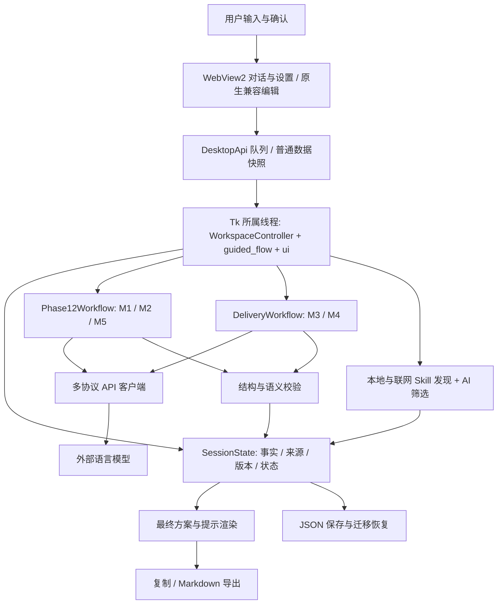
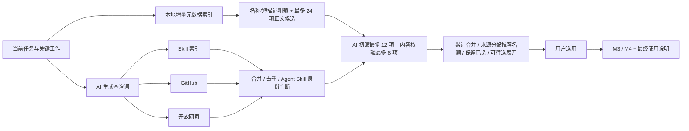

# 架构与内在逻辑

2026-10-13 启动入口：`workspace/startup.js` 是浏览器呈现门，首个有效工作区快照就绪后按已保存 `tutorial_status` 分流；not_started 点开始后打开操作教程，completed/skipped 自动进入。Hero 期间主表面 inert 且隐藏，快捷键和 command 同步阻止操作；SessionState/Tk 业务边界保持。`vendor/liquid-metal.js` 为本地 Paper shader，退出/pagehide 释放，减少动画时速度为零；不读取字体或请求模型。界面/窗口/导出/手动日志/EXE 名称改 Intext，包名/设置路径/DPAPI 身份兼容原数据。完整标题和侧栏英文为静态SVG路径，见[维护](maintenance/intext_hero_20261013.md)。

2026-10-13 教程状态：preferences只原子更新settings.json顶层tutorial_status（not_started/skipped/completed），保留模型档案和加密凭据，不访问或改写会话业务。WorkspaceController投影状态；完成校验当前视图戳；第五步无需发送任务即可点击完成；状态写入失败保留原状态并完整Debug。tutorial.js使用manual popover非模态操作引导，前四步依赖生产快照及settings本地保存/切换就绪事件解锁，第五步直接就绪；不定时推进、不代用户调用模型。关闭只隐藏本次、首页跳过与末步完成分别持久化，界面设置可重看。窄窗工作区保留可滚动操作区域。见[维护](maintenance/tutorial_20261013.md)。

2026-10-13 返回语义更新：SessionState在回答首次提交前保存一个有界answer_round_checkpoint，身份/Key/请求/API证据及trace不进入业务快照；整轮分批提交共用快照。返回interview在副本恢复，字段/类型白名单校验后原子落地，需求版本递增并重新核对；API证据完整保留，后续trace仅加入隐藏ID。workspace_drafts合并当前轮实时输入（含空串）与提交记录，answer_restore_id防止回退前迟到草稿覆盖；Web返回在原身份/stamp校验后直接携草稿，不等待flush，Tk取消前读取。旧会话以trace.history_count优先推断整轮并重建合法gap。其余阶段保持有效浏览位置；取消搜索resume_kind负责真实重启，focus_workspace_stage使新搜索退出旧结果。完整异常及恢复/重启生命周期同步Debug，无自动诊断落盘。165个不同本地节点最新均绿，原生合成28项通过，双轴0待修，未请求真实模型；详见[维护](maintenance/backtrack_answers_20261013.md)。

2026-10-13 联网Skill检索：skill_search保留索引name/description并生成最多6条短能力查询；open_skill_search在单查询份额、合并48项和正文读取之前均按元数据排序，skill_recommendation为各关键工作预留正分来源。GitHub集合按任务相关目录选择；查询词/热度不作为适配证据。AI低于0.4排除，失败仅对用途可解释的候选降级并标未核验；ui保存收集/复核/降级诊断和空结果类型。WorkspaceController过滤逐项搜索状态通知，Skills卡独立投影progress；JS局部更新进度、不重建表格或关闭详情。Debug完整原因和手动保存合同保持。四项275个不同本地节点、22项隔离WebView2合成检查通过，真实模型未请求，见[维护](maintenance/network_relevance_20261013.md)。下述批量/重命名实现阶段的延期验收现已完成。

2026-10-13 服务重命名：preferences.rename_provider_profile从保存档案构造新身份，活动顶层投影优先；先重新 DPAPI 加密/核对可恢复并迁移有效指纹，再原子写盘。WorkspaceController成功后在Tk owner线程退役旧目录任务并更新内存档案/连接版本，不走会清密钥的切服务回调。Web仅发送target/name/revision，密钥不进入浏览器。Skill工具栏只改变呈现，共用原source/show_all动作及忙态。实现与未执行验收边界见[维护](maintenance/provider_rename_skill_toolbar_20261013.md)。

2026-10-13 当前轮回答：Web 从当前快照对应题卡采集所有非空输入，经原有 command/stamp/Tk-owner 队列一次 answer；旧 id/text 协议保留。GuidedFlowMixin.submit_guided_answers 调用 SessionState.record_question_answers，以工作副本原子记录独立来源、同组历史和成功草稿清理，保留 SessionState 对象供两条 workflow 共用；一次刷新后仅在无剩余题时开始一次整理。Tk 回退复用同一入口；Debug 生命周期与精简投影同步，异常保留完整脱敏链。回归暂缓，见[维护](maintenance/batch_answers_20261013.md)。

2026-10-13 用户反馈：WorkspaceController在Tk owner线程捕获既有消息框/状态，通过有界notification序列和操作key投影；按操作合并派生重复、过滤草稿和目录标记。共享notifications.js/CSS为主窗口及Debug提供纯文本、脱敏、右上top-layer卡片，快照记忆与卡片生命周期分离以避免关闭后重放。每张独立5秒timeout，关闭/替换清计时；modal迁移按首显时间恢复CSS条。删除空位时读取当前视觉位置并以240ms transform补位，连续关闭衔接；固定可视区域防止临时滚动条且不拦空白点击。生命周期Debug不含正文或逐帧事件，完整异常和手动归档不变。详见[维护](maintenance/notifications_20261013.md)及[文案源清单](maintenance/notification_messages_20261013.md)。

2026-10-13 Debug展示投影：RuntimeLog的LogEntry保留完整text归档，并派生短time/source/message；DebugApi二次脱敏，仅对已知单行普通事件生成中文概要，警告及以上/未知/多行保持。Web以分栏和正文字符Range维护换行阅读锚点，复制使用实际渲染选择集合而非全部缓存；save仍独立读取完整内存归档，仅用户触发落盘。线程所有权与业务状态不变，详见[维护](maintenance/debug_log_view_20261013.md)。

2026-10-13 设置边界更新：Web配置使用串行settings_autosave和Tk owner原子写入，完整有效配置即可调用；显式Tk回退仍保留确认合同。changed_fields区分普通偏好，选择性保存不修改model_profiles/credentials/connection投影。Debug开关保留settings_debug独立忙时动作。目录获取仍只GET，不隐式保存模型草稿；过滤codex-auto-review贯穿协议目录、缓存和菜单。详见[维护](maintenance/settings_redesign_20261013.md)。

2026-10-13 自动目录：ModelDirectoryRefresh在PromptSmithApp初始化完成后读取已加载的保存档案，使用独立最多2线程池和每服务TaskScope获取目录；worker仅HTTP和入完成队列。Tk owner回写时验证scope/档案/连接/Key，复用save_model_directory再次核对保存身份，既不保存草稿也不确认模型或切换活动服务。手动获取、接口/Key变更、删除与关闭可取消旧目录请求；Web/Tk状态独立于对话busy，失败保留缓存并可手动重试。见[维护](maintenance/auto_models_20261013.md)。

2026-10-13 思考显隐：TraceView/ResponseTrace依据现有reasoning的实际非空内容派生内层入口/正文显隐，首片恢复而不重建writer或重置展开选择；不新增业务、模型能力或请求字段。无内容保留计时/活动/错误；隐藏时焦点交回可见标题，Debug只在显隐变化记录ID与布尔值。验证边界见[维护](maintenance/trace_visibility_20261013.md)。

2026-10-13 自定义服务类型与删除：connection.model_provider 对自定义档案必选，服务名称继续隔离凭据/目录身份，website 为独立元数据。ApiConfig.model_provider 指定别名模型的参数适配，明确类型优先，实际 wire model ID 不变；官方旧确认指纹保持兼容，旧无类型自定义保留 Key 并撤销确认。Web 公开 saved_providers/provider_families，设置按五家分组，目录未知 ID 依类型归类而不猜能力。delete_provider_profile 先原子落盘删除档案及活动投影，成功后再清内存并恢复默认服务；失败可重试，防止后续保存复活已删凭据。仅自定义可删除。实现和验证边界见[本轮维护](maintenance/custom_provider_20261013.md)。

2026-10-13 独立供应商设置：version2保留顶层活动connection/credentials/confirmation以兼容旧文件，新增model_profiles保存各家的接口、DPAPI密钥、模型参数、确认依据及目录。每次保存先同步旧活动投影，避免已清钥/撤确认被副本恢复；读取I/O失败中止保存并保留原文件。切换在Tk线程暂存/恢复档案并更新连接版本，Web settings_provider只返回公开快照。模型目录绑定provider/protocol/base_url/密钥身份，接口或Key变动清空；已保存同身份获取后缓存目录，不隐式保存草稿或确认。底部仅装饰获取ID，并携service_provider保证跨家相同ID不串凭据。本地MODELS不再提供未获取候选。详见[维护与验收](maintenance/provider_profiles_20261013.md)。

2026-10-12 Responses网关兼容：三个请求入口统一标准消息列表input及store=false；复杂业务Schema用完整提示JSON契约，合法简单Schema保留原生strict。无原生format时不重复兼容请求；非流式/缓冲JSON的failed状态也传播服务原因/request_id。用户模型/思考强度/预算与其它协议保留。验证边界见[维护](maintenance/responses_gateway_20261012.md)。

2026-10-12 流式失败诊断：`consume_sse()`保留服务原始stream_error及response.failed最新元数据；`api.py`共用HTTP/SSE错误字段提取与脱敏，将完整说明记录Debug、短说明传播既有ApiError/失败事件。服务错误不变成成功，不编造HTTP状态，不新增自动重试；运行日志仍手动落盘。见[复诊](maintenance/stream_service_error_20261012.md)。

2026-10-12 API兼容选择：`api.py` 对原业务Schema只读判断当前协议可安全原生接受的子集，Responses不兼容时仅用完整instructions JSON契约（不强加json_object），Messages不兼容时用完整system契约，Claude与OpenAI的可选字段规则分别处理；DeepSeek Messages仅保留effort。本地M1–M4解析及Schema不变，不为一般400扩大重试。Claude用adaptive/display=summarized公开摘要，GPT无公开思考正常完成；采样设置在已知模型请求适配，不再因会省略的组合阻止配置。默认源码batch明确Web模式及实际Python诊断，auto直接入口保留。见[维护](maintenance/startup_responses_20261012.md)。

2026-10-12 编辑窗口迁移：`web_editors.WebEditors` 在 Tk owner thread 持有临时编辑 id/owner/basis，`WorkspaceController` 对外投影 editor 数据并接收独立打开/保存/取消操作，`resources/ui/workspace/editors.js` 用原生 HTML dialog 渲染浅深模态面板。所有业务写入使用 SessionState/finalization 原方法，取消不写；正常 Web 导航不再显示 Tk 编辑页或等待 Tk 编辑对话框。Tk 继续是业务线程和显式回退，不参与 Web 编辑界面绘制。系统文件/目录选择保留。见[维护](maintenance/web_editors_20261012.md)。

2026-10-12 阶段呈现：conversation_cards 仅在方案核对阶段呈现已确认方案，过期历史保留；返回仍由 SessionState 导航管理。整合取消沿用原回调，放在 Skill 卡操作区，Web recovery 不重复收集；Debug 新增去重控件状态。见[维护](maintenance/stage_cleanup_20261012.md)。

2026-10-12 阶段返回（历史；回答撤回以2026-10-13记录为准）：`SessionState.workspace_navigation()` 只读推导实际路线和有效浏览位置，`navigate_workspace()` 持久化 control 中的位置/业务版本依据。返回不撤销确认，修改仍走原失效链；非法/陈旧位置退回自然阶段。方案核对改内联，需求确认后隐藏；Web返回绑定会话/操作/阶段/stamp且忙态先Stop，普通命令固定入口stamp并在draft flush后校验。Tk回退同步，Debug按动作和方案版本去重。见[维护](maintenance/plan_inline_20261012.md)与[验收](../verification/plan_inline_20261012/results.md)。

2026-10-12 整理/停止：`workflow.invoke_m1()` 单次模型请求、本地规范化与安全恢复，不再隐式纠正调用。`SessionState.edit_proposal()` 本地保存来源和版本，仅在原分析当前时延续分析依据。Tk所属线程仍拥有业务状态；每次session-scoped `_submit()` 生成独立 `_active_stop_token`，Web Stop核对会话与操作token、绕过草稿flush，取消TaskScope并隔离迟到回调。已有响应体通过socket.shutdown/close唤醒读；响应头前即时中断有界限。搜索来源恢复/持久化cancelled，trace取消终态关闭动画；首次恢复cancelled静态显示全文。思考预算耗尽且正文为空采用准确失败说明，完整参数与证据保留。详见[维护](maintenance/requirements_stop_20261012.md)与[验收](../verification/requirements_stop_20261012/results.md)。

2026-10-11 M1可靠性：首轮/增量共用 `M1_contract_v0.1.txt`，分别加载 system v0.25 / incremental v0.18，不再叠加旧基础提示。`workflow._complete_m1()` 统一每次真实调用的成本、耗时和 token 诊断，完整用户来源/Schema及模型参数保留；`clarification.answered_question_clarification()` 供解析与本地核对投影复用，保守比较已答问句，优先引用最近同 gap 答案，保留新增范围/否定/数量与主动补答。`validate_unknown_reviews()` 是无日志副作用的只读守卫，真正操作另有事件日志。见[维护](maintenance/interview_reliability_20261011.md)与[验收](../verification/interview_reliability_20261011/results.md)。

2026-10-11 历史会话：`SessionHistory`在本地history/index.json维护轻量目录和UUID记录，健康启动只读索引/stat；`HistoryWorkspace`在Tk所属线程捕获SessionState快照和浏览器草稿，单背景线程原子写入，切换/退出等候检查点。`_install_session()`统一恢复/取消/工作流重建，保留版本与显式确认；旧导入复制原文件，删除仅针对受管理记录。见[实现](maintenance/history_sidebar_20261011.md)与[验收](../verification/history_sidebar_20261011/results.md)。

2026-10-11 呈现迁移：Windows默认 `main.py --renderer auto` 进入WebView2，主工作区与设置同窗，Debug独立浏览器窗。`WorkspaceController` 在创建Tk的线程执行现有业务；`DesktopApi` 的Web线程只排队普通数据/读取快照，通过会话stamp和设置revision拒绝过期操作。首次同步失败会反馈并重试，关窗解除等待/关闭Debug/释放后台。`WebDebugConsole` 不持有Tk对象，新增JS异常与卡顿进入完整脱敏内存日志。明确模型确认、DPAPI、SessionState、取消和版本保护延续。复杂编辑可能打开Tk兼容窗，显式 `--renderer tk` 保留；缺WebView2预检时auto回退，显式web提示安装Runtime。详见 [迁移说明](maintenance/webview_workspace_20261011.md) 与 [验证边界](../verification/webview_workspace_20261011/results.md)。下列Tk呈现细节为回退及历史说明。

2026-10-11 最新跳过语义与结果适配：单题“跳过”是明确排除，历史保留供主动补答；不再进入前期阻断、M2–M4缺口、最终提示及导出。旧会话恢复时清理关联未知/草稿说明并保留原结果历史；“不确定”与整批先做草稿仍保留真实未知。形成当前方案后不自动再问细节，用户主动修改仍重新整理。“语气和附注”改为统一工作区锚定动画面板，不跳回旧结果页。Debug随排除、恢复、语气和附注操作同步。实现及验证见[本次修复](maintenance/skipped_delivery_20261011.md)。以下历史“跳过=使用时补充”说明以本段为准。

2026-10-11 当前访谈/方案UI调整：五轮仅为自动上限，信息充分即转需求核对，不设最低轮数，界面不显示访谈轮次。M1当前有效充分判断不会被本地普通缺口再次开启访谈；真实前期方向缺口、显式确认与版本保护保留。源码、视觉参考、数据等由用户交给下游AI，PromptSmith不索取实际文件、不因未上传而追问。M2新增未知不再自动转为题卡或阻断方案确认/Skill/交付；未知来源和内容保留到最终提示，历史主动补答仍使旧成果失效。问题框Enter提交、Shift+Enter换行；长问题按实际列宽重排。右上角新增“核对方案”动画面板，移入方案状态、完整内容和编辑/确认/Skill操作，对话不重复显示方案块，移除孤立“步骤”标题；删底部快捷键提示和状态文字，内部状态及Debug记录仍保留。实现/本轮验证见[本轮维护](maintenance/interview_completion_20261011.md)。以下2026-10-10的强制后置核对和最低/期望轮数说明为历史，按本段及当前代码执行。

2026-10-10 最新交互：全局原生字号改为125%；顶部需求核对/摘要锚定展开面板，删右上保存和旧需求详情/M5用户功能。底部采用用户玻璃按钮/圆角动画菜单的整理深度与任务类型；逐题紧凑圆角回答与图形发送/跳过，模型不生成可选建议；思考高度/chevron动画和独立滚轮已接入。当前范围与验证见[十项交互说明](maintenance/ui_refinement_20261010.md)，以下较早说明若冲突以本段及新说明为准。

2026-10-10 整页融合和保存时序：`_apply_workspace_theme()` 统一外壳/导航/时间线/输入外围和底部，空 Notebook 布局只撤除原生装饰，不改变页切换。`ui._submit()` 将完成屏障放入同一流式队列；元数据全部应用后主线程才执行业务回调，避免已完成保存为 working。仍按6ms/2000事件有界消费，回调不等待动画排空；取消/切换仍丢弃旧作用域，设置内部保留默认组件。

2026-10-10 回复区：`ResponseWorkspaceMixin` 在 `ConversationWorkspaceMixin` 下管理队列、持久化 trace 和逐题草稿；`response_ui.py` 负责 Hero/气泡/Markdown/折叠思考/自适应增量插入。`ui._submit()` 通过 ContextVar 观察本次 worker 的 `streaming.py` 事件，`api.py` 按 SSE 完整 UTF-8 事件接收，重建原 envelope 后继续原业务解析。Tk 仅在主线程更新，trace 不进入模型输入；TaskScope/会话实例/整合取消共同隔离迟到事件。问题可乱序逐题提交，最后聚合一次；原确认和访谈授权不变。见 [维护说明](maintenance/response_workspace_20261010.md)。

2026-10-10 默认字体：`typography.py` 从 `TkDefaultFont` 读取平台族名并派生内存字体，仅管理字号/粗体层级，不修改原生命名字体、不读取/生成字库或启动字体线程。自定义字体设置与 FontTools 运行/打包依赖已撤除；旧偏好忽略，保存剔除。模型确认依据只包含模型设置，既有 DPAPI 与确认继续兼容。`display.py` 仍在 Tk 创建前启用 DPI 感知。见 [本轮说明](maintenance/native_fonts_20261010.md) 与 [验收](../verification/native_fonts_20261010/results.md)。

2026-10-10 组件：`conversation.py` 使用 `composer.py` 的原生圆角输入区与 `ModelPicker`，`model_catalog.py` 维护模型名、描述/能力及四档思考映射；`api.py` 把映射用于三协议。菜单使用 Pillow 平滑图标、独立勾和隐藏复用；已确认相同接口内的模型/强度直接应用保存，首次接口或其它参数草稿仍在设置页确认。默认 High，旧自动档在验证原确认依据后迁移。SessionState 和请求版本/取消合同保留；主题/字号变化释放菜单。见 [组件](maintenance/composer_20261010.md)。

2026-10-10 前期访谈追加：M1 按相关维度全面提问，每批通过卡片逐题记录、统一整理。`interview.py` 和 SessionState 保存已展示批次与授权上限，默认五轮；第五轮起每轮结束，用户可选择“继续，再问一轮”或结束并明确保留未知。继续只授权一批，不自动确认；失败/修正与答案整理不计新轮，保存重开恢复批次进度。M2 使用来源 ID 引用紧凑前期问答，减少重复发现。统一时间线的需求卡片以类型/内容/来源/确认状态表格展示，选中读取全文，编辑/移除仍走原会话方法。详见 [维护说明](maintenance/interview_coverage_20261010.md)。

2026-10-10 需求核对追加：`clarification.py` 与 `SessionState.questions_for_review()` 只读派生未核对缺口/方案未知；原有问题历史记录显式答案和暂缓。需求/方案确认、Skill 和交付入口共用检查，前置问题优先于已确认阶段；回答使旧方案失效，问题组保留，最后一次整理聚合全部回答。暂缓只解除相同内容的核对要求，不自动确认，改变依据需再核对；已明确暂缓的普通事项继续随最终提示保留。预览/旧卡片及会话请求保护不变。222 个定向节点和 26 项实际 Tk 检查通过；详见 [维护记录](maintenance/unknown_clarification_20261010.md) 与 [验收](../verification/unknown_clarification_20261010/results.md)。

2026-10-10 统一验收：1000 节点分批覆盖与定向复验最新为 991 passed / 8 旧契约失败 / 1 环境跳过，41 项实际 Tk 通过。选用后两表按钮显示已选并禁用，重复操作不写业务状态；M1 兜底保留自动类别，未知保持未确认。完整范围和边界见 [本批报告](../verification/bug_batch_20261009/results.md)，无真实外部服务或新版 EXE 验证。

2026-10-09 联网访问追加（已离线回归）：`skill_http.py` 提供每轮三来源共享的有界缓存与入口暂停，官方 GitHub API 凭据、重定向隔离和 HTTP 分类；`_online_reader` 保留完整失败链并补脱敏目标。来源结果缓存区分 GitHub 凭据，线程用独立 copy_context 继承调用作用域，表格/选用仍通过原 SessionState。部分失败进入来源摘要，拒绝的索引/引擎不再反复查询，保留可用结果。详见 [联网访问修复](maintenance/skill_http_access_20261009.md)；真实站点拒绝效果仍待验。

2026-10-09 Skill 比较表追加（已离线/实际 Tk 回归）：`skill_browser.py` 提供来源/绑定只读投影与分配展示名额，`ui.py` 共用表格构造/刷新方法服务对话与详情。筛选、表格选中和展开是 UI 状态，实际选用仍由 SessionState 保存；原候选缺失时可投影已选快照。两种搜索都调用累计合并，同来源/工作/用途重搜更新，并保留绑定及 selected。默认推荐名额在来源间分配并额外带出已选项，避免全局截断隐藏本地结果。Debug 与用例见 [Skill 表格修复](maintenance/skill_table_20261009.md)。

本文件描述 2026-10-08 功能基线及后续统一对话、Skill 搜索优化后的结构，更新至 2026-10-10。启动入口为 `run_promptsmith.py`，将 `src/` 加入导入路径后调用 `promptsmith.main.main()`。

设置由 `preferences.py` 集中定义 31 项公开偏好（含 Debug 开关），`settings_ui.py` 的 SettingsMixin 构建五类设置并维护保存边界。公开连接、偏好及 API Key 密文原子写入应用 `settings.json`；`credentials.py` 通过 Windows 当前用户 DPAPI 保护密钥，绑定服务/协议/地址，不含应用内置密码，不允许明文回退。启动恢复后仍需独立确认。旧 `diagnostics.json` 开关在新设置未包含它时迁移，开关独立更新保留原密文且不提交模型草稿。模型参数编辑失效确认，模型确认仅保存模型类、连接与加密凭据；普通保存不会确认。每次搜索捕获不可变客户端与偏好/根目录快照，缓存键区分收集上限和来源超时。字体保存后即更新，窗口宽度下次启动按 16:9 适配。详见 [设置盘点](maintenance/settings_audit_20261009.md) 与 [凭据保护](maintenance/settings_security_20261009.md)。

M2 后续兼容修复：`parse_m2_response` 在合法 JSON/Schema 及请求身份检查后，对未决事项执行确定性归并，再校验方案引用。缺失的来源未知补回，新增项使用空缺口来源与可选关联需求；模型原响应和归并动作分别留存。`SessionState.plan_delivery_unknowns()` 为 M3/M4 和最终组装提供并集，不修改已确认方案。新最终基线的 `unknown_handling=ask_then_defer` 控制使用时继续追问的说明；旧最终基线继续按原格式核对。

## 1. 分层关系

这是一个桌面单进程应用，后台线程处理网络和模型调用。当前没有独立 HTTP 服务、数据库服务或浏览器前端。UI、状态、工作流已有一定分离，但大文件中仍有耦合，重构时须沿行为边界逐步拆分。

2026-10-09 的统一对话实现新增 `conversation.py`。它从 SessionState 的任务、question_history、当前需求/方案/Skill/结果构建只读卡片，输入与操作继续调用现有 UI/工作流方法。默认索引 0 为固定输入加独立滚动时间线，其他页面作为详情入口保留。没有新增独立聊天事实库或存储格式；重新打开会话可重建已发送问答与当前阶段内容，不虚构已被替换的历史模型回复。M1/M2、Skill 搜索和 M3/M4 的忙状态共同限制统一发送，原有请求/版本与主线程回调机制保留。

## 2. 五个模型模块

| 模块 | 输入依据 | 产出与作用 | 当前提示 |
|---|---|---|---|
| M1 | 用户原始任务、来源、现有要求、问答、已用/已授权轮次 | 理解候选、要求变化、缺口、完整题批、模型判断 | 共同契约 v0.1 + 首轮 v0.25 / 增量 v0.18 |
| M2 | 当前已确认需求快照、紧凑问答与真实来源 | 目标、范围、步骤、关键工作、输出与检查标准 | `M2_system_v0.6` |
| M3 | 已确认方案、候选 Skill 与其证据 | 分析适配性、前置条件与采用建议 | `M3_system_v0.1` |
| M4 | 选中绑定、具体工作、Skill 内容/摘要与来源 | 将 Skill 用途整合进最终任务方案 | `M4_system_v0.2` |
| M5 | 局部难以描述的要求及现有上下文 | 提供局部示例，收集用户反馈形成待确认内容 | `M5_system_v0.2` |

M1 契约仍为 `m1.v0.2`，M2–M5 契约为各自 `v0.1`。提示版本和结构契约单独管理。`resources/prompts/` 中旧文件用于兼容、测试与追溯；不是每个文件都会被当前请求使用。

2026-10-12 传输成本优化：`model_input.py` 只压缩可从完整来源精确重建的 M1 重复答案，原 SessionState、payload 和运行证据不变。M2 合并重复规则；M4 的步骤/工作正文放在顶层，baseline.plan 保留 ID 与其余依赖、需求覆盖及额外字段，最终交付仍读取原计划。小 Skill 候选集一次内容复核，大集合保留名称初筛；联网检索词只投影能力信号，成功规划按完整任务/工作/ApiConfig 哈希短期缓存，失败与取消不缓存，原候选核验保留。Responses 仅遇格式主体明确不支持才追加一次兼容请求，Schema 关键字错误及无关 400 不重发。思考强度、输出预算、用户确认和取消/版本保护不变。计量与边界见[本轮验收](../verification/token_efficiency_20261012/results.md)。

系统提示与 Schema 由程序提供，实例 JSON 作为任务数据。模型判断帮助推进，但用户确认、请求有效性、版本关联和落地变更由程序管理。模型边界先做可恢复格式整理，再对内部状态落地；内容缺失与格式差异尽量标为待核对，避免让提示词生成因建议完整性而阻断。

`model_output.py` 提供 JSON 围栏处理、额外字段记录、常见列表差异整理及所选 Skill 的参考贡献。M1 允许与真实待处理回答相连的历史缺口关闭，并协调“此回答充分但仍需追问”；无可靠落地结果时沿用现有访谈状态继续引导。M2 修整建议编号、循环/失效引用及需求覆盖，保留有效依赖，缺少说明明确为未知。M3 缺评估时保留条件参考，不制造新 Skill 来源。M4 从实际绑定补齐读取、任务输入/产物、检查与询问说明，未知前提、额外字段或非 JSON 建议作为附注。M5 的显示长度、维度差异、相同示例和约束冲突成为提醒，反馈继续只生成待确认候选；没有可读选项时仍提示直接回答/跳过。

## 3. 会话状态

`SessionState` 为中心状态对象；`promptsmith.session.v0.2` 是当前保存格式，包含旧格式迁移。

| 数据组 | 典型字段 | 设计含义 |
|---|---|---|
| 任务与来源 | `task_text`, `selected_category`, `sources`, `current_source_id` | 用户说过什么，与模型推测区分 |
| 需求 | `requirements`, `requirement_version`, `confirmed_requirements_version` | 当前要求与用户确认版本 |
| 分析与待处理 | `pending_proposals`, `pending_questions`, `gaps`, `open_conflicts`, `last_model_judgment` | 需求分析过程及未决项 |
| 请求 | `pending_requests`, `api_runs`, `errors` | 请求身份、执行与诊断记录 |
| 初始方案 | `plan`, `plan_archive` | 内容、来源需求版本、方案版本和确认版本 |
| Skill | `skill_state`, `bindings`, `search_state` | 搜索进度、候选、选择快照与用途 |
| 最终结果 | `final_result`, `final_archive`, `delivery_revision` | 正文、版本、来源依据、确认与后续补充 |
| 示例 | 示例反馈相关记录 | 用户偏好反馈来源 |

任务/需求改变会影响已生成方案与最终结果；方案修改会影响相关 Skill 绑定和最终交付。保留旧内容可以追溯，但不能把旧版本自动显示成当前已确认版本。

Skill 绑定包含记录快照、来源哈希和关键工作映射。取消绑定后重建贡献与来源，不能只把列表中的一行隐藏。最终文本由 `finalization.py` 组装，Skill 名称、链接/路径与用途来自当前绑定，避免仅依赖模型是否复述。

## 4. 一次异步调用如何完成

1. UI 同步当前输入，准备请求、版本和配置快照。
2. 工作流 `prepare_*` 建立合法输入及请求标识。
3. UI `_submit()` 将耗时调用放到后台；`_poll_completions()` 在 Tk 主线程接收结果。
4. `invoke_*` 完成 API 请求、解析、校验和证据记录；有明确范围的恢复路径，实际请求数应查日志。
5. 返回时检查请求身份、会话版本与配置世代。取消或迟到结果不得覆盖新工作。
6. `apply_*` 更新业务状态，然后刷新界面。

后台线程不能直接操作 Tk 控件。UI 改版要保留忙碌态、完成回调、取消后的保护和窗口关闭清理。

会话切换追加（2026-10-09，已离线回归）：`task_scope.py` 提供线程内 ContextVar 与 Event 取消作用域，`_submit` 绑定原作用域，操作开始/完成及 Tk 回调均检查。新建/打开会话复位通用/M5/搜索/交付忙状态，M1/M2 捕获原工作流和实例 token；旧阻塞请求占线程时退休原执行器，新请求使用新执行器。HTTP 发送/返回及自动修正边界停止后续旧调用；已发出的服务端推理无法保证即时撤回。索引预热使用应用作用域。最终提示试运行实现及专用历史字段已退役，仅保留旧数据兼容忽略。范围和验证记录见 [会话切换修复](maintenance/session_switch_cancellation_20261009.md)。

API 默认结构化请求上限 8192 tokens，生成等待阈值 120 秒；连接探测与模型列表采用较短阈值。服务可能只支持部分协议或参数；连接成功不等于所有正式请求兼容。

## 5. Skill 发现与选择

本地默认发现位置由当前用户目录和运行目录动态计算：用户 `.codex/skills`、`.agents/skills`、Codex 插件缓存；项目 `skills`、`.skills` 及相应隐藏目录。不存在的目录会跳过。换电脑可能没有已安装 Skill，零结果应作为可理解状态展示。

`local_skill_index.py` 在应用数据目录 `cache/skill_index/` 持久化名称、短描述、开头片段及哈希；启动后台预热，搜索时枚举文件并按路径、mtime_ns/size/ctime_ns 更新变化项。未变化文件不重读元数据，缓存损坏或不可写可降级。`local_skill_search.py` 按元数据排序后最多读 24 项正文构造来源候选，文件变化或删除时跳过该项并保留其它结果。

`skill_recommendation.py` 按名称/短描述及关键工作筛到默认最多 12 项，为明确的任务能力保留名额。本地 `skill_ai_selection.py` 在大于正文复核名额时先按元数据 AI 初筛，之后默认最多核验 8 项正文；本地完整文件重读并验证哈希，但长于 4,000 字符的正文仅向模型发送首尾节选且说明未读全文，去除重复的 source 字段。联网则使用 `summary_only=True`，直接发送独立 description、有界 brief、任务与关键工作，一次 AI 请求为候选给出 0～1 评分、理由和用途，不再执行额外元数据 AI 初筛，最终默认最多推荐 8 项。简介最长 1,600 字符、brief 最长 2,000 字符，不重复发送完整正文。每轮适配筛选累计系统提示与业务 JSON 默认最多 60,000 字符，任务上下文最多 6,000 字符；超过预算停止追加请求并保留未核验候选。字符预算不是 token 预算，也不覆盖联网检索词生成与后续 M3/M4。

合并结果按 0～1 推荐系数排序，默认 6 项推荐名额在来源间分配，额外带出已选项，可筛选来源或展开全部。分数是相对推荐强度，不是成功概率；本地节选证据最高 0.85，仅元数据最高 0.69；联网简介评分保留模型原分并明确标注未阅读全文。低于 0.4 排除。JSON 代码块、数字字符串和个别坏行可恢复；简介模式零有效评分明确失败，与有效低分无匹配区分。模型失败回退到有限且有用途依据的名称/描述粗筛结果，并标注尚未核验、显示脱敏原因；用户取消不触发降级。完整正文哈希和业务绑定的来源校验仍保留。当前合同及验证见 [简介评分维护](maintenance/skill_summary_scoring_20261014.md)，早期离线测量见 [Skill 搜索验证](../verification/skill_search_20261009/results.md)。

网络三路并行，各自默认 45 秒发现预算。查询词生成、正文补充与 AI 筛选的时间另计；网站限流、人机验证、接口不可达可能产生部分结果。普通网页或普通仓库不能仅凭主题相关就冒充 Skill；明确的 Skill 索引条目或 `SKILL.md` 身份用于准入。

内容核验明确区分完整正文、正文节选和仅元数据；文件哈希校验不等于模型读过全文。推荐不代表已安装或执行。UI 需要把“适合做什么”“证据是否有限”“由用户选用”讲清楚。

## 6. 最终交付与一般待补充项

无 Skill 路径可由程序组装最终文本；选用 Skill 的路径可经模型整合或直接组装。`reference_contribution()` 从真实绑定及关键工作生成使用指引；缺少完整格式、未核对前提、不兼容判断或未获方法适配确认均作为下游读取/询问说明。`build_final_draft()` 补齐所有当前选用项，不能因此加入未选 Skill。正文、复制与导出共享渲染结果。

用户要求核心问题前置解决，末端一般待补充内容留在最终提示中继续完善；不能恢复旧的“所有待复核都阻止复制导出”机制。对迟到结果、无效引用、过期依据等仍有程序保护，需区分内容尚可补充与对象已失效。

Skill 整合内容不再需要先通过完整性审查。内部状态仍保护任务/请求身份、来源快照、用户确认、取消和版本失效；M1/M2 的不可落地结构、空响应或明确的错误请求身份不能直接写成已确认事实。失败后由 UI 提供具体继续入口，并保留用户工作。验证边界见 [宽松接收与失败引导](../verification/validation_relaxation_20261009/results.md)。

语气包装与语义正文分离。产品交付最终提示，由用户复制或导出到下游 AI 使用。

## 7. 存储与资源

- 默认会话及运行证据分别位于 `%LOCALAPPDATA%/PromptSmith/sessions`、`runs`；无该环境变量时使用用户目录下 `.promptsmith`。
- `storage.py` 管理会话读取写入，业务迁移和有效性逻辑在 `session.py`。
- API Key 不随会话序列化；全局设置中的凭据以 Windows 当前用户 DPAPI 密文保存。仓库不带团队共享密钥。
- 模型配置在独立设置页由用户显式确认；`model_confirmation` 保存版本和公开连接、规范化模型参数、DPAPI 密文记录的指纹，与配置和凭据同次原子写入，不保存明文密钥或其散列。启动核对指纹、恢复密钥、匹配实际连接并通过本地 ApiConfig 验证后，恢复运行时确认快照。普通保存仅延续已有有效确认，非模型/Debug 偏好不使确认失效；旧文件首次明确确认后可恢复。连接测试只探测，获取模型只填充候选，均不确认配置。模型字段编辑清除运行时确认，并继续更新连接版本以隔离迟到响应；环境覆盖或恢复失败提示核对后重新确认。
- 源码启动通过 `paths.py` 找到仓库 `resources/prompts`；冻结 EXE 使用 PyInstaller 的 `_MEIPASS` 资源目录。
- 打包配置显式列出兼容提示与 Schema。移动或修改资源时，同时核对加载器、测试和 `PromptSmith.spec`。

## 8. 运行诊断

`main.py` 在导入 UI 前建立 `RuntimeLog`，绑定根 logging handler 并将级别设为 DEBUG。日志包括时间、线程、级别和模块；同时采集 stdout/stderr、Python warnings、未捕获进程/线程异常及 unraisable 清理异常。启动记录 Python、系统、解释器、工作目录与冻结状态；后台 `_submit()` 记录操作、任务 ID、耗时和完整异常链，Tk 完成队列与回调错误在主线程记录。现有信息/警告/错误对话框经统一包装写入日志后继续显示。Skill 文件、缓存和网络降级也记录完整错误，API 包装保留底层 cause。

运行记录只驻留内存，构造、启动、采集和退出均不创建或修改运行日志文件。Debug 控制台“保存日志”调用 `RuntimeLog.save()`：先 flush 未换行 stdout/stderr，锁内取得完整记录快照，锁外逐条脱敏写 UTF-8 临时文件，完成后原子更名为 `%LOCALAPPDATA%/PromptSmith/logs/Intext_<时间戳>_<唯一编号>.log`；不存在该环境变量时沿用 `.promptsmith/logs`。每次保存完整快照，不覆盖旧文件；保存后的新增记录留在内存，后续点击再保存。保存故障清理未完成文件，保留错误及完整堆栈供重试。密钥变量和环境 token 注册到脱敏器，凭据字段与 Bearer 形式也统一屏蔽；保存时再次脱敏，不把请求正文另行打印到运行日志。`RunEvidenceWriter` 仍按原有机制保存结构化请求/模型响应证据，并在运行日志记录请求身份、校验结果与文件位置。

Windows Web模式由 `WebDebugConsole` / `DebugApi` 向独立WebView2窗口投影脱敏增量日志；JS未捕获异常与操作失败通过窄diagnostic入口记录。`--renderer tk` 回退的 `DebugConsole` 是只读 `Toplevel`，通过 Tk `after(150ms)` 从有序内存日志读取增量；handler 不接触 Tk 控件。显示缓存默认 1,500 条、窗口约 6,000 行；独立完整内存记录用于保存，较早记录不会因显示缓存上限而丢失。筛选、清屏和关窗只影响显示。完整内存记录随日志量增长，未保存内容在进程退出或崩溃后不可恢复，手动文件没有自动轮转/清理。INFO 白色、WARNING 黄色、ERROR 红色、DEBUG 蓝色、CRITICAL 亮红色。开启偏好统一保存于 `settings.json`；关闭窗口取消该偏好，应用正常退出保留偏好用于下次恢复。窗口显示未保存、已保存记录数/文件路径或保存失败。应用关闭先等待后台、恢复 Tk/进程入口，再解除 handler。验证边界见 [运行日志验证](../verification/runtime_log_20261009/results.md)。

模型兼容操作以 WARNING 记录恢复动作和请求编号，`check.json.normalization` 保留细节，`response.raw.txt` 保留原返回，`response.effective.json` 留存有效结果。M3/M4 保存有效结果，M1/M5 在发生兼容时保存，M2 沿用有效结果机制。运行日志不重复打印整段任务/响应；准备、调用、解析和主线程落地失败保留完整异常链。兼容接收不应被标为完全核验。

同批追加（已离线回归）：M1 将唯一对应来源原文的省略号/空格/大小写差异在本地还原为逐字引用，保留用户确认与未知来源保护；自动修正中间尝试由 ERROR 改为 WARNING，最终失败仍 ERROR，所有异常堆栈继续记录。程序兜底保留有效已有类别，不从损坏输出猜类别或确认要求。原因和检查见 [M1 引用恢复](maintenance/m1_quote_recovery_20261009.md)。

## 9. 技术说明中如何准确表述

自主实现包括需求/方案状态管理、AI 交互流程、Skill 发现与关联、最终交接生成和异常处理。外部语言模型、公开 Skill 及第三方库标明来源。既有论文提供提示研究基础，软件新增机制的效果须另测。

当前架构可用于画技术方案图，但“多模型智能路由”“自动下载安装 Skill”“已完成全网遍历”“跨平台全面验证”等不属于现有已证实能力。

2026-10-13最新教程呈现：非操作区域用黑色25%透明SVG遮罩压暗，控件留洞原亮度、遮罩不拦点击；滚动/尺寸/快照更新跟随，关闭释放观察器和动画。每步首次满足条件时一次礼花替代绿色完成提示；重复快照不重放，减少动画时只解锁下一步。前四步仍按真实操作解锁，第五步直接可完成、无需发送目标。仅点击完成保存completed，中途关闭不写完成，首页skip保持独立。
