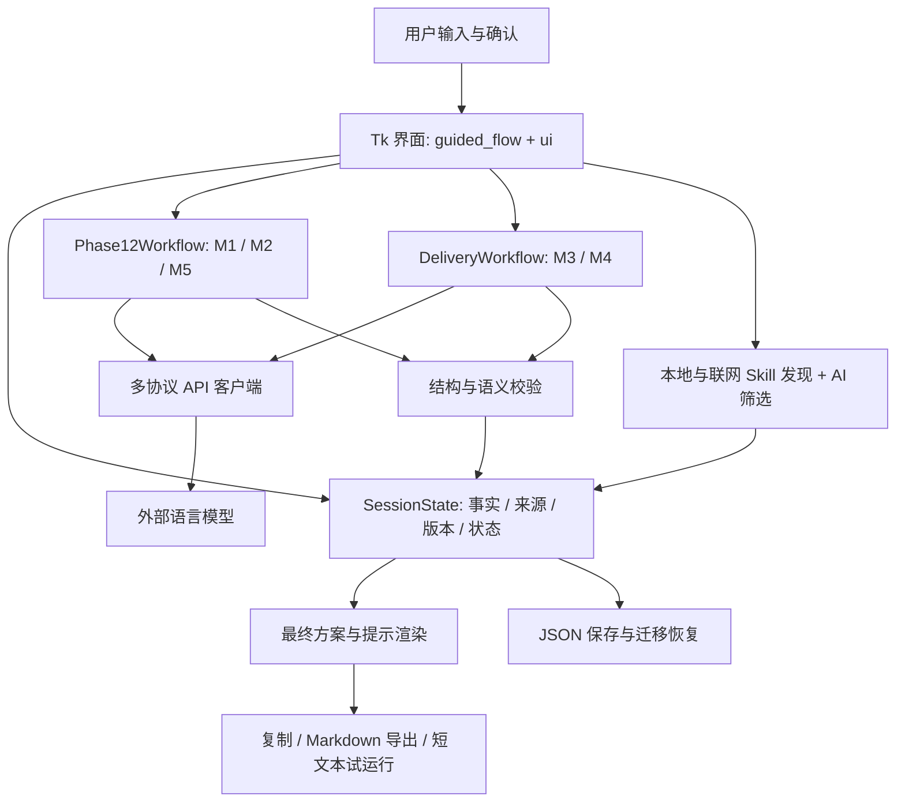
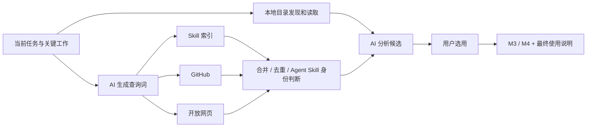

# 架构与内在逻辑

本文件描述 2026-10-08 功能基线及仓库资源迁移后的结构。启动入口为 `run_promptsmith.py`，将 `src/` 加入导入路径后调用 `promptsmith.main.main()`。

M2 后续兼容修复：`parse_m2_response` 在合法 JSON/Schema 及请求身份检查后，对未决事项执行确定性归并，再校验方案引用。缺失的来源未知补回，新增项使用空缺口来源与可选关联需求；模型原响应和归并动作分别留存。`SessionState.plan_delivery_unknowns()` 为 M3/M4 和最终组装提供并集，不修改已确认方案。新最终基线的 `unknown_handling=ask_then_defer` 控制使用时继续追问的说明；旧最终基线继续按原格式核对。

## 1. 分层关系

这是一个桌面单进程应用，后台线程处理网络和模型调用。当前没有独立 HTTP 服务、数据库服务或浏览器前端。UI、状态、工作流已有一定分离，但大文件中仍有耦合，重构时须沿行为边界逐步拆分。

## 2. 五个模型模块

| 模块 | 输入依据 | 产出与作用 | 当前提示 |
|---|---|---|---|
| M1 | 用户原始任务、来源、现有要求、问题回答及控制信息 | 理解候选、要求变化、缺口、追问、模型判断 | 基础 v0.18 + v0.22 附加；增量基础 v0.11 + v0.15 附加 |
| M2 | 当前已确认需求快照 | 目标、范围、步骤、关键工作、输出与检查标准 | `M2_system_v0.2` |
| M3 | 已确认方案、候选 Skill 与其证据 | 分析适配性、前置条件与采用建议 | `M3_system_v0.1` |
| M4 | 选中绑定、具体工作、Skill 内容/摘要与来源 | 将 Skill 用途整合进最终任务方案 | `M4_system_v0.2` |
| M5 | 局部难以描述的要求及现有上下文 | 提供局部示例，收集用户反馈形成待确认内容 | `M5_system_v0.2` |

M1 契约仍为 `m1.v0.2`，M2–M5 契约为各自 `v0.1`。提示版本和结构契约单独管理。`resources/prompts/` 中旧文件用于兼容、测试与追溯；不是每个文件都会被当前请求使用。

系统提示与 Schema 由程序提供，实例 JSON 作为任务数据。模型判断帮助推进，但用户确认、请求有效性、版本关联和落地变更由程序管理。Schema 只检查部分结构，还需要语义引用与来源检查。

## 3. 会话状态

`SessionState` 为中心状态对象；`promptsmith.session.v0.2` 是当前保存格式，包含旧格式迁移。

| 数据组 | 典型字段 | 设计含义 |
|---|---|---|
| 任务与来源 | `task_text`, `selected_category`, `sources`, `current_source_id` | 用户说过什么，与模型推测区分 |
| 需求 | `requirements`, `requirement_version`, `confirmed_requirements_version` | 当前要求与用户确认版本 |
| 分析与待处理 | `pending_proposals`, `pending_questions`, `gaps`, `open_conflicts`, `last_model_judgment` | 需求分析过程及未决项 |
| 请求 | `pending_requests`, `api_runs`, `errors` | 请求身份、执行与诊断记录 |
| 初始方案 | `plan`, `plan_archive` | 内容、来源需求版本、方案版本和确认版本 |
| Skill | `skill_state`, `bindings`, `search_state` | 搜索进度、候选、选择快照与用途 |
| 最终结果 | `final_result`, `final_archive`, `delivery_revision` | 正文、版本、来源依据、确认与后续补充 |
| 示例和试运行 | 示例反馈相关记录、`trial_runs` | 用户反馈来源与显式执行记录 |

任务/需求改变会影响已生成方案与最终结果；方案修改会影响相关 Skill 绑定和最终交付。保留旧内容可以追溯，但不能把旧版本自动显示成当前已确认版本。

Skill 绑定包含记录快照、来源哈希和关键工作映射。取消绑定后重建贡献与来源，不能只把列表中的一行隐藏。最终文本由 `finalization.py` 组装，Skill 名称、链接/路径与用途来自当前绑定，避免仅依赖模型是否复述。

## 4. 一次异步调用如何完成

1. UI 同步当前输入，准备请求、版本和配置快照。
2. 工作流 `prepare_*` 建立合法输入及请求标识。
3. UI `_submit()` 将耗时调用放到后台；`_poll_completions()` 在 Tk 主线程接收结果。
4. `invoke_*` 完成 API 请求、解析、校验和证据记录；有明确范围的恢复路径，实际请求数应查日志。
5. 返回时检查请求身份、会话版本与配置世代。取消或迟到结果不得覆盖新工作。
6. `apply_*` 更新业务状态，然后刷新界面。

后台线程不能直接操作 Tk 控件。UI 改版要保留忙碌态、完成回调、取消后的保护和窗口关闭清理。

API 默认结构化请求上限 8192 tokens，生成等待阈值 120 秒；连接探测与模型列表采用较短阈值。服务可能只支持部分协议或参数；连接成功不等于所有正式请求兼容。

## 5. Skill 发现与选择

本地默认发现位置由当前用户目录和运行目录动态计算：用户 `.codex/skills`、`.agents/skills`、Codex 插件缓存；项目 `skills`、`.skills` 及相应隐藏目录。不存在的目录会跳过。换电脑可能没有已安装 Skill，零结果应作为可理解状态展示。

网络三路并行，各自默认 45 秒发现预算。查询词生成、正文补充与 AI 筛选的时间另计；网站限流、人机验证、接口不可达可能产生部分结果。普通网页或普通仓库不能仅凭主题相关就冒充 Skill；明确的 Skill 索引条目或 `SKILL.md` 身份用于准入。

正文可读时使用正文，只有摘要/索引信息时保留证据差异。推荐不代表已安装或执行。UI 需要把“适合做什么”“证据是否有限”“由用户选用”讲清楚。

## 6. 最终交付与一般待补充项

无 Skill 路径可由程序组装最终文本；选用 Skill 的路径经过模型整合，程序补齐可靠的来源和用途信息。正文、复制与导出共享渲染结果。

用户要求核心问题前置解决，末端一般待补充内容留在最终提示中继续完善；不能恢复旧的“所有待复核都阻止复制导出”机制。对迟到结果、无效引用、过期依据等仍有程序保护，需区分内容尚可补充与对象已失效。

语气包装与语义正文分离。短文本试运行是显式操作，可能调用付费 API；软件不会因为展示最终提示就自动执行下游任务。

## 7. 存储与资源

- 默认会话及运行证据分别位于 `%LOCALAPPDATA%/PromptSmith/sessions`、`runs`；无该环境变量时使用用户目录下 `.promptsmith`。
- `storage.py` 管理会话读取写入，业务迁移和有效性逻辑在 `session.py`。
- API Key 为运行时配置，不随会话序列化。仓库不带团队共享密钥。
- 模型配置在独立设置页由用户显式确认；确认快照同样只保留在运行时。连接测试只探测，获取模型只填充候选，均不确认配置。任意连接字段变更清除确认，并继续更新连接版本以隔离迟到响应。
- 源码启动通过 `paths.py` 找到仓库 `resources/prompts`；冻结 EXE 使用 PyInstaller 的 `_MEIPASS` 资源目录。
- 打包配置显式列出兼容提示与 Schema。移动或修改资源时，同时核对加载器、测试和 `PromptSmith.spec`。

## 8. 技术说明中如何准确表述

自主实现包括需求/方案状态管理、AI 交互流程、Skill 发现与关联、最终交接生成和异常处理。外部语言模型、公开 Skill 及第三方库标明来源。既有论文提供提示研究基础，软件新增机制的效果须另测。

当前架构可用于画技术方案图，但“多模型智能路由”“自动下载安装 Skill”“已完成全网遍历”“跨平台全面验证”等不属于现有已证实能力。
