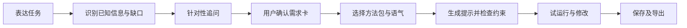

> 历史资料：仅用于追溯当时的设计与验证；当前状态以根目录 HANDOFF.md 为准。原始路径：`output/archive/赛题二参赛方案_20260920机制借鉴版.md`。原始日志、截图及失效旧链接的查找方式见归档索引。

**需求引导式提示构建助手：赛题二参赛方案**

修订日期：2026-09-20。状态：供三人团队讨论和落实的方案，功能与实验均为待实施设计。本版结合九张聊天截图、既有论文和赛题二规则，替代此前以教学评测实验台为主体的建议。术语统一使用“提示工程”；具体输入文本仍可称“提示”或“提示词”。

**建议定位：帮助用户把模糊想法转成清楚、完整、可检查的 AI 任务提示。**

用户先说明要做什么，软件通过有针对性的追问补齐信息，把答案整理成可修改的需求卡，推荐适合的 Skill 方法包，再生成提示并允许试运行、检查与导出。礼貌语气是其中一个可控因素，论文中的对照方法用于评价生成结果与资源消耗。

建议作品名暂用“需求引导式提示构建助手”，突出软件帮助用户澄清需求并构建提示的实际功能。“提示工程”用于说明项目的技术方向，论文中的语气研究与对照方法作为研究基础。正式名称在核心功能确定后定稿；首个场景与具体模型仍属本版建议。

**一条完整的产品流程。**

产品要交付的价值是降低遗漏关键条件、反复补充和组织提示的负担。是否做到，需要新测试来回答；不能预写“提高准确率”“降低费用”等未经验证的效果。

**聊天形成的方向与本版取舍。**

聊天的关键转向在图6：礼貌只占应用的一小部分，主体是了解用户任务的相关因素并定制提问。图7增加了可选 Skill，图8—9仍在讨论模型接入和 AI 的具体作用。逐图梳理见[聊天思路总结](<../聊天思路总结-20260920.md>)。

据此，本版将需求澄清、结构化整理和提示生成作为主流程；保留语气模块、质量与消耗观察；把旧版完整批量评测平台缩为团队内部的测试能力和少量历史案例。这样既响应新讨论，也保留论文的实际贡献。

**论文怎样进入产品。**

研究基础为[《提示词语气对国产大语言模型输出结果的影响分析》](<../../../competition/sources/202608V14N5-13.pdf>)。以下页码均指 PDF 实际页码。原文研究的是中文客观题中的语气变化，没有研究本方案的完整提示工程流程。

| 论文内容与证据 | 新版中的具体用途 | 必须保留的解释边界 |
|---|---|---|
| 第3—5页：固定题目、输出要求与调用条件，设置五档语气；59份有效问卷检验了原五条表达的礼貌层级 | 把语气与任务事实、输出格式分开存储；切换语气时锁定其他内容，生成可核对的差异 | 原五条表达的感知检验不能证明软件新生成的所有表达都具有相同分级效果 |
| 第6页：礼貌相对中性准确率变化为 DeepSeek +0.157、Doubao +0.000、Qwen +0.420 个百分点，尚无统计显著优势 | 保留“中性／适度礼貌”的选项；如采用适度礼貌默认值，说明是产品表达选择 | 不声称礼貌必然提升质量，也不把客观题结果外推到开发、写作等任务 |
| 第6页：词元变化依赖模型；DeepSeek 粗鲁语气下总词元比中性增加约12.8% | 试运行记录原始词元用量；方案同时评价任务完成情况与资源消耗 | 词元不等于账单、能耗或推理质量，12.8%不是新软件的普遍节省比例 |
| 第4、7页：对显性回答作规则辅助片段分类；校正规则所用240条片段上的一致率为77.92% | 借鉴“不能只看最终结果”的观察方法，检查新场景输出是否覆盖目标、约束、交付物和验收条件 | 原“选项分析”等类别不直接适用于软件需求；新检查规则须另行验证，77.92%不是新模块准确率 |
| 第5页：635道题、五档语气、三模型、三次重复，共28,575条正式记录，保留答案与用量日志 | 用于论文证据展示、原统计复核；检查后复用模型调用、日志、用量汇总等通用代码 | 是历史研究记录，不是28,575名用户，也不是新产品效果实验；现有源码尚未提供核验 |
| 第7页：讨论“适度礼貌、任务明确、输出约束清楚”，并指出开放任务的适用边界 | 形成产品假设：把语气、需求内容和输出约束纳入同一个可检查流程 | 这属于从论文启发出发的软件扩展，论文未单独证明需求澄清或 Skill 组合的收益 |

项目叙事可写成：

> 前期研究发现，提示语气对模型表现的影响具有任务和模型依赖性，资源消耗与显性回答结构也值得同时观察。基于该研究，我们拟将语气控制与对照评测方法融入需求引导式提示构建助手，进一步开发需求澄清、结构化整理和方法包组合能力，让用户能够构建并检验适合自身任务的提示。

前三项是研究背景及方法继承，后几项是新增软件工作。两部分要分别提供证据。

**首个场景建议：学生与小团队准备 AI 辅助软件开发需求。**

这是为了使剩余工期可控而选出的示范场景，来源是聊天中的“开发一个软件”例子，并非团队已经确认。首先让软件帮助用户明确要交给 AI 的需求、开发任务和验收条件；首版交付停在提示准备与结果试运行，不承诺自动开发和部署整套项目。

可验证的需求假设是：这类用户常有初步想法，却不确定需要向 AI 提供哪些背景、限制和完成标准。第一天找两名符合场景的人，用他们的真实任务检查这一假设。如果团队更容易接触其他用户，可以替换场景字段和方法包；不要同时扩展所有工作类型。

以下是虚构的交互示例，仅用于说明设计，不是实际试用成果。

用户输入：“帮我做一个活动报名网站。”

软件先识别这是一个软件开发准备任务，再询问尚未提供且会改变方案的条件，例如：

- 给谁使用？只做单个活动还是要管理多个活动？
- 必须有哪几项功能？是否需要名额限制、重复报名检查、名单导出？
- 是课程演示还是实际上线？完成时间、已有技术基础是什么？

假设用户回答：“课程演示，单个活动，报名与名额限制，管理员导出名单，两周完成，熟悉 Python，不需要付款。”软件把这些答案整理为需求卡；用户可纠正或删除。

| 字段 | 用户已确认的示例内容 |
|---|---|
| 目标与场景 | 两周内完成课程展示用的单活动报名网站 |
| 核心功能 | 报名、名额限制、管理员导出名单 |
| 明确边界 | 不做付款 |
| 已有条件 | 熟悉 Python |
| 本次希望 AI 输出 | 需求规格、开发任务拆解、验收清单 |
| 尚未确定 | 管理员如何登录、报名信息如何处理等，以待确认项保留 |

启用“开发任务拆解”和“验收检查”方法包后，可生成这样的提示片段：

> 请根据以下已确认需求，给出适合两周完成的最小软件方案。项目用于课程展示，管理单个活动，必须支持报名、名额限制和管理员导出名单，不包含付款。开发者熟悉 Python。请输出功能范围、开发任务及其依赖、逐项验收条件。管理员登录方式等未确定事项请单独列出，不要自行假定为已确认需求。每项新增建议应标为可选项，并说明理由。

界面同时说明关键句的来源，例如“来自用户第2次回答”或“由验收检查方法包加入的输出要求”。因此，用户能检查生成过程有没有改变自己的意思。

**提问机制：稳定字段加少量动态追问。**

固定字段保障覆盖：任务目标、受众或使用者、已有材料、硬性限制、期望输出、验收标准。场景字段帮助细化：软件开发可增加运行环境、功能边界、数据输入输出、时间与技术条件。

AI 先从原始输入提取已知信息，再针对关键缺口生成问题。已经说明的内容不重复询问；冲突信息优先澄清。初版建议默认两轮，每轮不超过三个关键问题，用户可以选择“不确定”、继续追问或先生成草稿。轮数是交互预算，不是需求已经完整的判定，也不是论文推导出的最优值。

参考已核验的 grill-me/grilling，给关键字段增加轻量前置关系，只询问当前前提已经明确的问题；用户改变前置决定时重新检查相关字段。首版用字段依赖表即可，不开发通用决策树引擎。来源和版本见[相关Skill调研](<../相关Skill调研与借鉴建议-20260920.md>)。原 grilling 每轮询问整个可问前沿，本方案的少量问题和预算属于面向用户负担的改造。

借鉴范围限定为提问选择、前后依赖、回答后的状态更新与结束确认等机制。团队根据目标用户重新编写内部指令和用户问句，不照搬原 Skill 的具体提示语言或固定问答格式。内部给模型的规则、规则要求的呈现方式、用户实际看到的问题需要分别检查，不能仅凭内部指令的文风判断实际对话一定生硬。

用户问句应承接已经提供的信息，直接询问一个具体决定，避免术语堆叠、重复复述和每轮固定的客套开场。复杂选择可附少量选项，理由仅在有助于判断时给出，不要求每题固定展示“分析—建议—确认”。例如用户已说“给社团做活动报名页”，可以问“这个报名页是给大家实际用，还是先做个演示？”；若回答实际使用，再问“报名后，成员需要自己修改或取消吗？”这只是本项目拟议表达示例，不是上游原句。自然表达关注可理解性与回答负担，与论文中的礼貌程度是不同变量；访谈措辞不作为论文语气结论的验证。

每个需求字段保存“已确认／待确认／系统建议”状态。用户没有回答或确认推荐内容时，不得自动变成事实；达到默认交互预算后，把缺口列在提示和报告里，并允许继续补充。如果缺少任务目标等基本信息，只生成待完善草稿，并解释还缺什么。可从用户已授权材料查明的事实先核对，属于用户意愿的决定仍由用户作出。

对于完整输入，应允许跳过追问直接确认需求卡。验证时要测试这条路径，避免把多问问题误当成产品效果。

**Skill 在首版中定义为可选的任务方法包。**

聊天没有明确 Skill 是何种技术形态。为确保可实现，本版建议每个方法包包含：适用任务、必要输入、处理步骤、输出结构、检查要点、来源与版本。用户选择后，确实改变提示所要求的工作方式与交付物。

| 首版方法包 | 加入的具体作用 | 用户能观察到的变化 |
|---|---|---|
| 需求规格整理 | 按目标、功能、边界和待确认项组织需求 | 生成的提示要求输出相应栏目，保留需求来源 |
| 开发任务拆解 | 将功能转成有限阶段、任务与依赖 | 提示中增加任务排序和范围限制要求 |
| 验收检查 | 给每项必需功能定义可检查的完成条件 | 生成的提示要求逐项验收，避免只有笼统描述 |

首版只整理这三个方法包，推荐最多两个，用户可改选或不选。匹配先根据确认的任务类型和期望交付物做简单规则筛选，AI 可解释推荐理由；无适合项就明确显示没有推荐。

组合规则要具体：用户确认的硬约束优先；共用要求合并去重；方法包提出的额外范围标为建议；冲突内容提示用户处理。需求卡编辑后重新检查受影响的提示片段。

这实现了聊天中“帮助用户找到适合的 Skill 并选择”的意图。首版不宣称具备外部插件安装、任意工具执行或多智能体调度；可将方法包内容编入可复制的普通文本提示，便于在其他模型中使用。如以后接入特定平台的 Skill 文件格式，再单独适配和验证。

**语气模块做小，但有实质作用。**

普通用户界面提供“中性”和“适度礼貌”。初版可默认适度礼貌、简洁表达，同时允许切回中性；这是根据论文启发作出的交互选择，适用于新场景的效果仍待验证。

语气切换只能改变请求措辞，保持已确认事实、方法包、约束、输出要求和验收标准一致。最好先用受控措辞替换形成变体，避免让模型自由润色整段后同时改变任务内容。两版本的差异应可见。

论文中的五档语气保留在研究说明和内部复核中，无需把全部档位放在产品主界面。语气说明可简短写成：“既有研究未发现礼貌程度与准确率呈简单线性关系，请结合当前任务试用。”不预填最佳语气或预计提升分数。

**AI 与软件各自承担什么。**

| 工作 | 实现角色 | 为什么进入产品核心 |
|---|---|---|
| 从自然表达中识别目标、条件与缺口 | 接入大模型，返回结构化结果 | 用户无需先掌握一套完整表格写法 |
| 根据具体缺口提出问题、理解回答 | 大模型 + 字段状态与提问轮数控制 | 同一场景内，不同需求会触发不同追问 |
| 匹配方法包 | 简单规则为主，解释可由模型辅助 | 三个方法包无需另建复杂推荐模型 |
| 生成提示、解释改动来源 | 大模型 + 固定格式与约束检查 | 将用户意图组织成可编辑的提示 |
| 检查字段遗漏、保存版本与导出 | 普通软件逻辑 | 使生成过程可核对、可恢复、可复用 |
| 用生成提示试运行 | 调用任务模型 | 查看实际输出，支持修改和验证 |

大模型检查可以辅助发现语义遗漏，但不能保证检测全部偏离；用户确认与测试仍然必要。本产品不应声称每个组成模块都是新 AI 算法。AI 的实质贡献在需求理解、动态追问与生成；工作流设计、规则和交互是团队需要独立完成的软件工作。

“自己做一个 agent”在此可理解为用既有模型构建受控工作流，无需训练基础模型，也无需引入多智能体。帮助生成提示的模型与执行该提示的模型是两个使用角色，首版可以使用同一个模型服务。

**模型接入与离线方式。**

| 方式 | 建议优先级 | 能力与限制 |
|---|---|---|
| 团队服务端接入一个可用模型 API | 首版主方案 | 用户在网页操作，无需本地部署模型；团队负责额度、密钥和失败提示 |
| 用户配置自己的 API | 后续选项 | 增加灵活性，也增加配置与支持成本；不作为首版必经步骤 |
| 无模型的离线表单模式 | 有余力再做 | 可依规则分支填写、编辑保存内容、套用已内置模板和导出；无法进行同等水平的语义理解和自由追问 |

离线也能交互，表单、分支问题和编辑功能不需要模型。没有云端连接且没有本地模型时，应明确降低能力，不能标成完整 AI 推理模式。由团队服务器调用模型仍然是在线方式。

具体模型从团队已持有合法可用账户的服务中选一个。先检查中文理解、结构化返回、响应时间、费用与当前接口可用性；论文比较过三模型，不代表首版必须实时接入三个，也不能直接据此选出新任务的最优模型。

如已有 Python 代码和相应经验，可用 Streamlit、现有调用模块、SQLite/文件存储完成首版；若已有成熟 Web 基础则沿用。核心数据只需需求卡、选中方法包版本、生成提示、模型配置与运行结果。生成失败时保存已填内容，接口失败时可重试和导出已生成提示，密钥保存在服务端且不随报告输出。

**最小交付范围。**

| 必须完成 | 具体验收方式 |
|---|---|
| 任务输入与针对性追问 | 对有缺口与信息完整的两类输入，分别追问和跳过已知项 |
| 可编辑、可确认的需求卡 | 修改硬约束后，后续生成使用新值；未知项保留状态 |
| 三个内置方法包，按需推荐与选择 | 选用、取消后可以看到输出要求的实际变化，不能只是显示标签 |
| 提示生成与两种语气 | 保留用户事实与限制，语气变化不修改任务要求 |
| 一模型真实试运行 | 能获得结果并记录原始用量、耗时及失败原因 |
| 保存、复制与一种文件导出 | 导出需求卡、提示、方法包与运行配置，重新打开可追溯 |

界面可集中为三步：需求引导、需求卡与方法包、提示与试运行。批量效果对照先由团队脚本完成，不必做复杂用户端实验页面。历史论文结果可放在研究基础说明中。

本轮暂缓：多模型路由、Skill 商店、大量外部技能接入、浏览器插件、本地大模型部署、自动训练、自动开发整套软件、完整批量评测平台。若前几天未跑通主流程，优先取消离线模式和历史图表等增强项；仍需保留真实 AI 追问与生成，不能降成只填表的静态网页。

**如何验证新产品，并延续论文的方法。**

研究问题改为：“引导式需求澄清与方法包组合，能否帮助用户生成更完整、约束更清楚的任务提示，并改善后续输出的任务符合程度？”语气是可以单独研究的变量，不预设哪一档胜出。

第一组证据验证需求引导。准备10—12个软件需求准备案例，每个案例事先写好初始简略需求、关键补充事实、潜在冲突和验收清单。另留几个开发案例调试规则，正式评价案例不要参与反复调优。测试系统是否问到关键缺口、是否重复询问已知信息、是否无依据补全事实。案例答案由人工按预定事实提供；漏问的信息不能由后台悄悄补入。

第二组证据验证端到端与等信息条件下的表现：

| 条件 | 输入与处理 | 可解释的比较 |
|---|---|---|
| A：原始提示 | 初始简略需求 | 用户未经辅助的起点 |
| B：普通润色 | 同一初始需求，由同一模型按固定“改善表达但不补造事实”的指令处理 | 与常见一次改写方式比较 |
| C：等信息普通表达 | 以D最终确认的需求卡为准，把全部事实、硬约束与待确认状态用固定普通文本格式呈现，包含用户主动新增及修改的信息 | 控制补充信息数量，作为结构组织的对照 |
| D：完整流程 | 实际完成追问、确认需求卡、方法包选择、提示生成 | A与D比较整体流程；C与D比较同一事实条件下的组织及方法包组合 |

C与D必须共享同一套已确认事实，C不添加D未获取的信息；两组不含的关键事实仍按预定评分表记缺失。生成后人工核对信息一致性；若D生成的提示漏掉已确认约束，应计为生成错误，不得从C删除该约束来配平。通过这种安排，追问和生成失败也会反映在完整流程结果里。各组最终交给相同任务模型，使用同一公共要求输出“需求规格与可验收的开发任务清单”，并统一模型参数、语气与输出上限，避免某组独享评分格式。D可使用内部结构和方法包，但不能通过得到额外任务事实赢得等信息比较。

评价至少报告：关键需求覆盖率、硬约束违背数、无依据新增需求数、可检查的验收条目情况、流程失败率。先确定评分规则，再隐藏组别，由两名成员分别评阅原始输出并处理分歧。自动规则可检查格式和明确字段，不能替代全部语义判断；无需临时建立一个未经验证的大模型裁判。

10—12个案例×4条件×1次下游运行，约40—48次任务模型调用。这不包括追问、润色和生成提示的额外调用，先用少量案例估算总预算。时间与用量分别报告准备阶段、下游执行阶段及全流程合计；不要只算最后一次调用。输入、输出、缓存和推理词元按接口口径记录，避免重复相加。费用只有在计费规则明确时才估算。

这些样本用于初步案例验证，不能宣称普遍提高软件开发成功率。A与D的差异不应全部归因于提示措辞，C与D也只支持组合效果；如果要单独声称某个 Skill 有效，需要在相同事实、语气和其他条件下增加关闭该 Skill 的对照。

已有同类Skill的检索提示还应加入E基线：同一模型直接使用固定版本 grilling 指令。统一可用材料、用户事实回答规则、资源上限与最后的产出要求，比较整体流程质量及成本。grilling本身聚焦访谈，最终提示的整理步骤须明确标为评测附加步骤并计入开销；不能把额外步骤冒充其原生功能。10—12个案例加入E后约需50—60次下游调用，另计追问与生成开销。完整的比较建议见[相关Skill调研](<../相关Skill调研与借鉴建议-20260920.md>)，不增加产品端批量评测页面。

**语气效果保留为独立的小型验证，不与主实验混淆。** 若工期与预算允许，从预先确定的新任务中取相同案例，将D的提示复制成中性与适度礼貌两个版本，锁定事实、结构、方法包、模型及参数，只修改措辞；人工检查变体未改变任务信息。比较任务符合程度与词元，不预设提升。预算不足时只展示论文历史证据，并明确新场景的语气效果尚未验证。

主实验之外，请3—5名非开发成员完成真实任务，记录主动操作时间、等待时间、追问次数、修改次数、是否成功导出，以及哪里需要帮助。直接询问“与直接让聊天模型帮你优化提示相比，这个流程具体省去了哪一步？”若更多提问反而增加负担，也应记录并修改交互。

同时记录用户看不懂、觉得重复或难以回答的具体问句，用于调整表达。原版 grilling 继续作为已有方法的实验参照，不要求产品沿用其文案；若改写基线指令，应另标“适配版”。用户体验比较不预设原版更生硬，也不把“更自然”单独写成算法创新。

图5中关于结果相近的顾虑，可以这样处理：演示允许挑选容易讲清流程的案例，但测试报告必须包含事先选定的全部案例、相近和退化结果，以及失败记录。若礼貌没有明显优势，保留为表达偏好；若整个流程没有改善，就据实定位价值并继续修正，不能靠删除不理想样本得出结论。

**如何说明创新与赛题适配。**

赛题二允许算法、数据相关工具及 AI 软件，要求完成核心功能、算法与功能契合，提供说明、算法介绍、测试和部署资料。依据为[比赛规则](<../../../competition/sources/JSAI2025-1.pdf>)第4页。提示工程属于相关技术方向，但仅使用这个名称不能证明创新；本产品应以真实的需求理解、动态追问和生成流程证明 AI 的作用。

最值得验证的差异化是：有来源的需求卡、会避开已知信息的追问、可选择且实际影响结果的方法包、语气与任务内容分离、结果与消耗可核对。通用聊天也可能完成其中很多工作，所以需对比操作成本、约束保留和复用体验，不把“接入大模型”写成全部创新。

| 评分项 | 分值 | 本方案应准备的证据 |
|---|---:|---|
| 创新性 | 20 | 与直接聊天、普通润色及少量真实同类工具的具体比较 |
| 技术实现 | 20 | 真实模型调用、结构化状态、失败恢复、约束检查与运行日志 |
| 功能完整性 | 20 | 输入到需求确认、方法包、生成、试运行和导出的完整任务 |
| 方案完整性 | 20 | 需求、架构、方法、开发分工、测试、部署与边界 |
| 应用价值 | 15 | 目标用户实际任务、完整案例评价、小规模试用 |
| 总结与展望 | 5 | 如实说明效果与不足，有依据地规划扩展 |

以上权重来自规则第5页，不构成获奖或得分预测。2026-09-20已核验 grill-me/grilling、grill-with-docs、brainstorming、to-spec、goal-prompt 等公开Skill；连续追问和结构化整理已有实现，不能单独视为本项目独创。差异化应通过可追溯需求卡、场景交互、可控语气和实际质量／成本结果来证明。当前未完成全面竞品调查或运行对照，不使用“首创”“唯一”等表述；引用与复用按对应许可注明。

**按剩余时间执行，不重新计算三周。**

最初在9月15日提到只剩三周，今天为9月20日，约已过去五天。若原时限未变，可暂按约16天安排；比赛文件本身未给准确截止日，实际日期应立即从报名系统核对。下面暂按9月20日启动，安排到10月3日的14天核心计划；这些是建议工作日期，不是已知比赛日期。晚启动一天就相应缩短开发时间，不能整体顺延；若正式截止更早，优先预留最后三天给材料和提交，再压缩功能。

| 时间 | 可检查的交付结果 |
|---|---|
| 第1—2天，9月20—21日 | 定一个场景与一个模型，访谈两名用户，检查旧代码，完成需求卡字段、三个方法包和两种语气规则；运行最小真实调用 |
| 第3—5天，9月22—24日 | 跑通输入→动态追问→确认需求卡→方法包选择→生成提示→复制导出 |
| 第6—7天，9月25—26日 | 完成单模型试运行、约束与来源检查、保存和失败恢复；第7天冻结核心功能 |
| 第8—10天，9月27—29日 | 完成10—12个案例对照、3—5人试用及关键缺陷修复；材料持续填写真实结果 |
| 第11—12天，9月30日—10月1日 | 干净环境安装验证，完成软件说明、核心方法、测试报告、技术方案和答辩材料 |
| 第13—14天，10月2—3日 | 录制演示、检查匿名与格式、上传预检并提交；实际允许的剩余时间处理提交或运行故障 |

| 成员 | 持续负责的工作 |
|---|---|
| A：AI流程与方法 | 模型接口、信息提取与追问、方法包组合、语气变体、约束检查 |
| B：产品与工程 | 页面交互、需求卡编辑、保存导出、试运行展示、部署与恢复 |
| C：研究与验证 | 复核论文可复用资产、建立案例和评分表、组织试用、核对日志、整理参赛材料 |

三人共同审查示例和正式评分。第5天若主流程仍未闭合，取消逐句来源解释与历史版本浏览，只保留字段级来源和单次会话保存；约束检查先限定为已确认字段与明确禁项，不实现通用语义审查。取消离线模式与历史图表增强；第7天之后停止增加场景或模型。代码与数据目前仍未出现在本次检查的原始材料目录中，不能预设旧代码无需修改即可支撑新流程。

**参赛材料如何讲清楚。**

约4分钟的视频可按以下顺序安排：20秒展示模糊需求及用户困扰；50秒展示针对性追问和需求卡；40秒展示方法包选择与语气设置；60秒展示提示、来源及真实试运行；40秒展示保存导出与新测试结果；30秒说明论文贡献、适用边界及下一步。已保存结果与实时运行要明确标记，删去等待时间需说明。

现有规则第3—4页要求：名称不超过20字、简介不超过300字；技术方案按模板和大纲，PDF不超过10M；视频MP4、3—5分钟、300MB以内；答辩PPT提交为PDF；佐证材料合并为PDF；代码等大容量材料按规定命名并通过永久有效百度网盘分享提交。软件说明、核心算法说明、测试报告需包含技术栈、环境与部署方法。

论文可作为佐证，但其首页有学校与教师信息，需按规则的匿名要求处理并核实组委会规定。规则中的作品材料不得出现学校名称、Logo、指导教师等信息；源码包不包含密钥。当前PDF存在印刷页码跳页，也未包含完整资格、准确截止日期或重复参赛细则，应核实本届完整通知。

拟议作品简介如下，待实现后按真实功能和测试结果更新：

> 本项目拟开发“需求引导式提示构建助手”，面向AI辅助软件开发中的需求准备环节。系统运用提示工程方法，通过针对性追问形成可编辑的需求卡，结合可选任务方法包与语气设置生成提示，支持模型试运行、结果追溯及导出。项目结合前期提示语气研究的控制变量方法与质量、词元消耗联合观察思路，拟通过任务案例和用户试用验证需求完整性、约束保持及使用效率。

本版是AI辅助整理的内部方案，未实施新实验，也未把拟开发功能写成完成成果。聊天截图已按顺序保存在原始材料目录；2026-09-16旧版保存在归档目录，便于核对方案变化。
